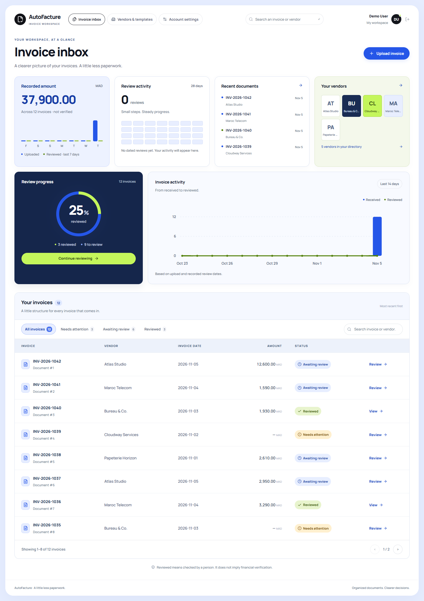
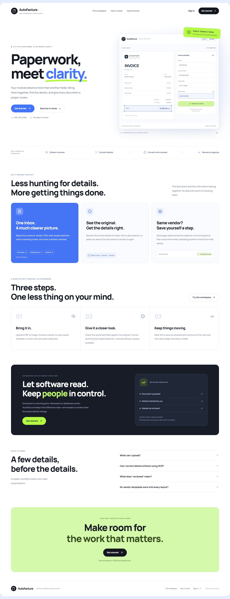
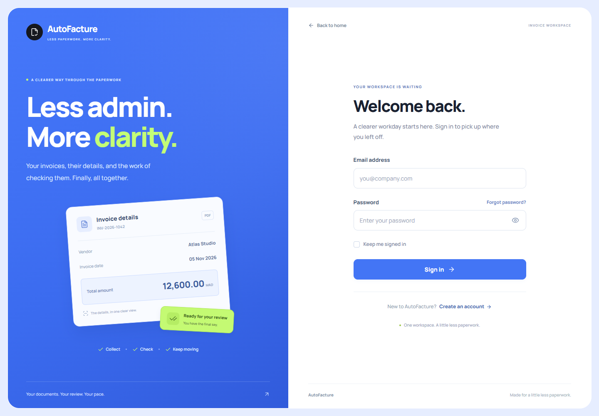
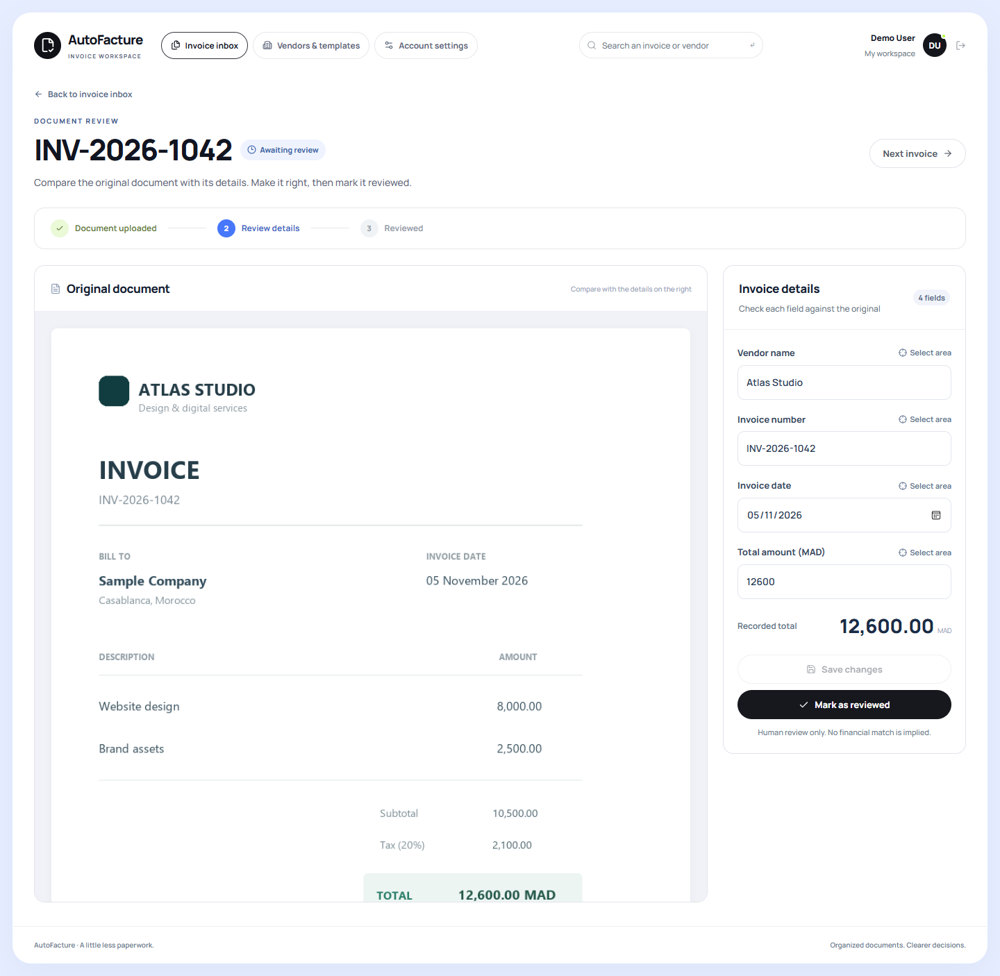
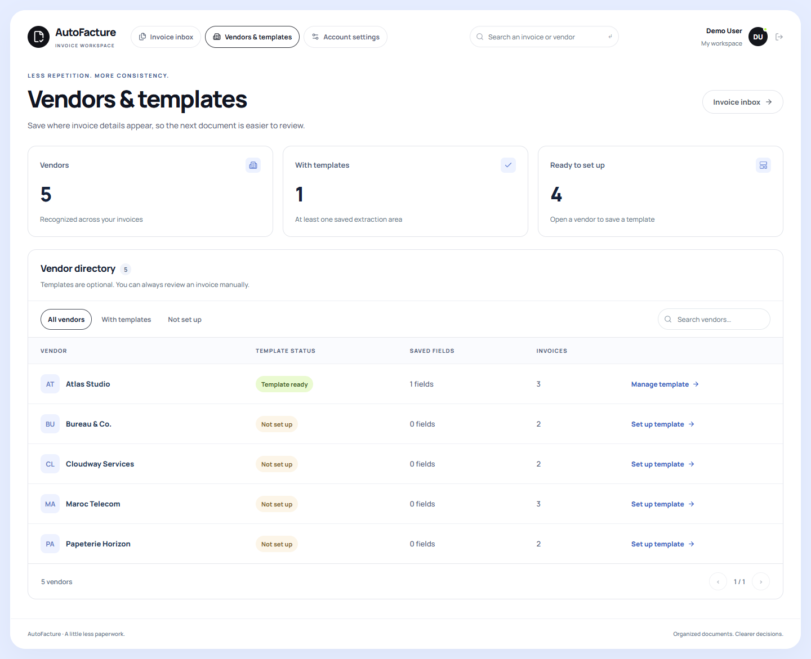
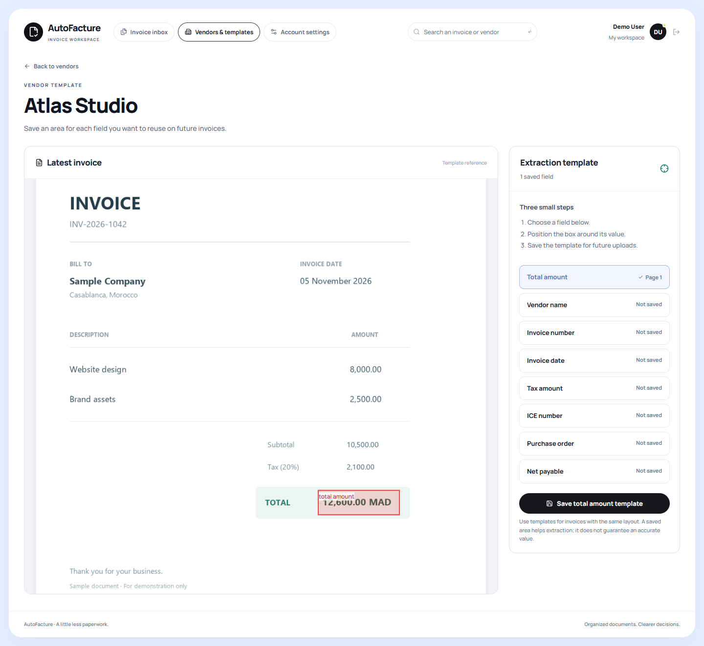
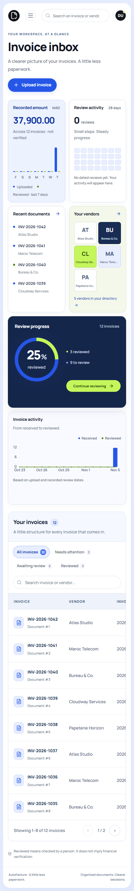
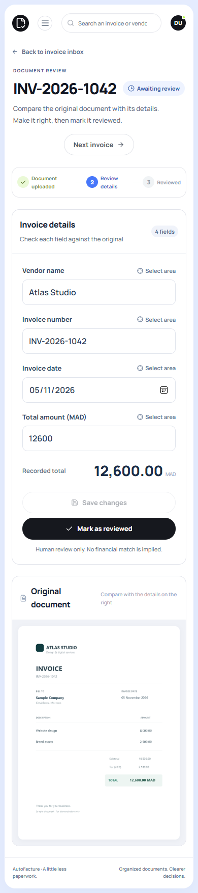

# AutoFacture
### A little less paperwork. A clearer invoice workflow.

**Full-stack invoice management · Document review · Vendor extraction templates**

Laravel · React · Inertia.js · PostgreSQL · Python · FastAPI

[Product tour](#product-tour) · [Workflow](#workflow) · [Engineering](docs/engineering.md) · [Full gallery](docs/gallery.md)

## The project

AutoFacture brings invoice uploads, extracted information, manual corrections, and review status into one workspace. It is designed around a practical idea: document extraction helps people work faster, while people remain responsible for checking the result.

This repository is a **visual portfolio showcase**. It contains screenshots and project documentation. Application source code, uploaded documents, credentials, database files, and model artifacts are not distributed here.

## What it does

- **Invoice inbox:** search documents, filter by review status, and track recorded amounts and recent activity.
- **Upload workflow:** accept PDF, JPG and PNG documents, with file validation and an optional vendor selection.
- **Human review:** inspect the original document beside editable fields, save corrections, and mark an invoice as reviewed.
- **Vendor templates:** define document regions for reusable extraction fields.
- **Account access:** registration, sign-in, password recovery and confirmation, and email verification screens.
- **Responsive interface:** desktop and mobile layouts with visible labels, keyboard focus, and consistent feedback.

## Product tour

### 01 — An introduction to the product

A product homepage explains the workflow and leads into the workspace.

### 02 — A focused sign-in experience

A branded layout, strong typography, clear field labels, and password visibility controls carry the product identity into authentication.

### 03 — Review alongside the original

Invoice details stay beside the source document. Users can correct fields before completing a review.

### 04 — Reuse what you know about a vendor

A vendor directory leads to extraction templates, where users can select document regions for individual fields.

### 05 — Keep the workflow usable on mobile

<table>
<tr><td width="50%"></td><td width="50%"></td></tr>
</table>

## Workflow

1. Upload an invoice and optionally select its vendor.
2. Receive extracted information from the document-processing service.
3. Inspect the original document and correct fields as needed.
4. Save changes and explicitly mark the invoice as reviewed.
5. Return to the inbox to continue with the next document.

Manual field corrections can be demonstrated independently of OCR. **Reviewed** records a human review action; it does not certify financial or tax accuracy.

## Technology

| Layer | Technologies | Responsibility |
| --- | --- | --- |
| Application | PHP, Laravel | Authentication, invoice records, validation, review state, document access |
| Interface | React, Inertia.js, Tailwind CSS, Vite | Navigation, forms, document review and responsive layouts |
| Data | PostgreSQL | Application database configuration |
| Processing service | Python, FastAPI | Document-processing API used by the Laravel application |
| Document tools | EasyOCR, pdfplumber, pypdfium2 | OCR and PDF processing |
| Visual system | Manrope, Lucide icons, custom CSS | Typography, iconography and cobalt/lime/navy identity |

## Design decisions

- **Cobalt for actions and incoming activity**, lime for review progress, and navy for the primary review panel.
- **Readable Manrope typography** gives headings and amounts clear hierarchy.
- **Explicit status labels** accompany color so users can understand review state without relying on color alone.
- **Separate save and review actions** make the human checkpoint visible.
- **Side-by-side document review** keeps evidence close to the editable data.

## Current status

The application UI and manual review workflow are implemented. Production frontend builds, authentication tests, and browser checks have been run during development. Screenshots here were captured from a local preview with sample data; they are a visual demonstration, not a hosted application.

**End-to-end OCR accuracy testing is pending.** This showcase makes no extraction-accuracy, performance-benchmark, or production-deployment claims. Email delivery was not exercised for these captures.

## About this repository

The sample invoice values and vendor records are for demonstration. The workspace identity in portfolio captures is shown as Demo User. The local screenshot preview used SQLite; the application is configured for PostgreSQL separately.

For a screen-by-screen overview, see the [gallery](docs/gallery.md). For implementation structure and tradeoffs, see the [engineering notes](docs/engineering.md).

Copyright is retained by the project owner. No license to the private application source code is granted by this showcase.
